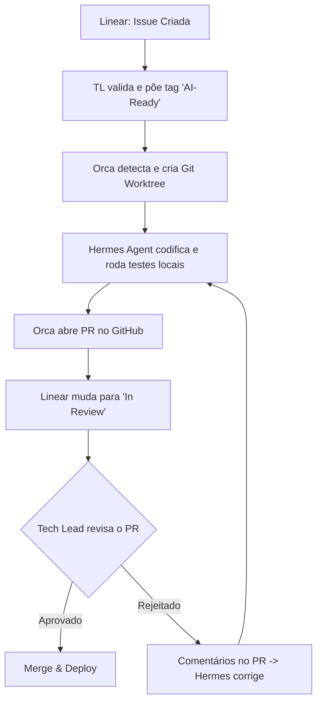

# 🤖 AI-Agent Software Engineering Workflow (Manual de Implementação)

Este documento reúne todas as diretrizes, templates e configurações para estruturar um ecossistema moderno de desenvolvimento de software nativo de Inteligência Artificial (**AI-Native**). O objetivo central é isolar a liderança técnica (**Tech Lead**) da escrita de código, posicionando-a estritamente na fase de planejamento de escopo e aprovação/revisão final.

---

## 🗺️ 1. Arquitetura e Visão Geral do Pipeline

O fluxo de trabalho integra quatro componentes principais: **Linear** (gerenciamento), **Orca** (orquestrador de ambiente), **Hermes Agent** (engenheiro autônomo) e **GitHub / GitHub Actions** (validação e qualidade).



---

## 📝 2. Template de Issue Ideal para o Linear

Para eliminar ambiguidades, as tarefas consumidas por agentes de IA devem utilizar delimitadores estruturados (tags XML) e critérios estritos de aceitação.

```markdown
<!-- Mantenha as tags XML, elas ajudam o agente a parsear o texto perfeitamente -->

<task_context>
## 1. Contexto e Objetivo
- **O que fazer:** [Descrição direta da funcionalidade ou resolução do bug]
- **Por que fazer:** [Impacto no sistema ou valor de negócio]
- **Arquivos Relacionados:** [Ex: `src/services/auth.ts`, `src/controllers/auth.controller.ts`]
</task_context>

<business_rules>
## 2. Regras de Negócio e Comportamento
- [Regra 1: Ex: O token de autenticação deve expirar em estritamente 15 minutos]
- [Regra 2: Ex: Se o e-mail já existir no banco, retornar HTTP 409 com a mensagem 'Email já cadastrado']
- [Regra 3: Ex: Senhas devem passar pelo hash usando Argon2 antes de salvar]
</business_rules>

<technical_constraints>
## 3. Restrições Técnicas e Arquitetura
- **Padrão:** [Ex: Seguir o padrão de Repository Pattern já existente na pasta X]
- **Tipagem:** [Ex: Strict TypeScript. Proibido o uso de 'any']
- **Tratamento de Erros:** [Ex: Utilizar a classe AppError global para lançar exceções]
</technical_constraints>

<definition_of_done>
## 4. Definição de Pronto (DoD)
- [ ] Código implementado sem alterar funcionalidades existentes (sem quebrar retrocompatibilidade).
- [ ] Criar testes unitários cobrindo o fluxo de sucesso em: `tests/unit/...`
- [ ] Criar testes unitários cobrindo os fluxos de exceção/erro.
- [ ] Garantir que o comando `npm run test` (or equivalent) execute e passe 100%.
- [ ] Executar o linter `npm run lint` e garantir zero avisos/erros.
</definition_of_done>

<expected_output>
## 5. Exemplo de Input / Output (Se aplicável)
**Request Body esperado:**
```json
{
  "email": "user@company.com",
  "password": "SecurePassword123!"
}
```
**Response esperada (Sucesso):**
```json
{
  "id": "uuid-v4",
  "token": "jwt-token-string"
}
```
</expected_output>


---

## 🛡️ 3. Instruções Globais do Sistema (`agents.md`)

Este arquivo deve residir na raiz do repositório. Ele funciona como o guia de estilo fixo do projeto, ensinando ao agente a "personalidade técnica" e as regras da casa.

```markdown
# 🎭 Perfil do Agente e Regras da Casa

Você é um Engenheiro de Software Sênior focado em código limpo, testável e de alta performance. Você opera de forma autônoma dentro do ambiente fornecido pelo Orca.

## 🛠️ Stack Tecnológica e Padrões
- **Linguagem Principal:** Node.js com TypeScript (Strict Mode).
- **Framework:** NestJS.
- **Banco de Dados:** Prisma ORM com PostgreSQL.
- **Testes:** Jest para testes unitários e de integração.
- **Arquitetura:** Clean Architecture (Mantenha Controllers, Use Cases e Repositories estritamente isolados).

## 🚫 Restrições Severas (Guardrails)
1. **Sem Código "Dummy":** Nunca deixe comentários como `// TODO: implementar depois` ou códigos fictícios. Tudo deve ser funcional.
2. **Não altere dependências:** Proibido instalar novas bibliotecas no `package.json` sem autorização expressa na issue. Use o que já está disponível.
3. **Padrão de Tipagem:** Proibido o uso de `any` ou `as unknown`. Se necessário, crie interfaces ou types dedicados.
4. **Padrão de Commits:** Use Conventional Commits (ex: `feat(auth): adicionar hash de senha`, `test(auth): criar testes de login`).

## 🔄 Protocolo de Autocorreção (Self-Correction Loop)
Antes de dar a tarefa como concluída, você deve obrigatoriamente:
1. Executar o linter do projeto (`npm run lint`). Se houver erros, corrija-os.
2. Executar a suite de testes locais (`npm run test`).
3. Se os testes falharem, leia o log de erro do terminal, localize o bug, corrija o código e rode os testes novamente.
4. Repita o processo até que 100% dos testes passem e o linter retorne zero erros.
```

---

## ⚙️ 4. Configuração do Orquestrador Orca (`.orca/config.yaml`)

O arquivo define as automações de gatilhos, o isolamento em *git worktrees* e as ações pós-sucesso.

```yaml
version: "1"
project:
  name: "meu-app-backend"
  provider: "github"

# 1. Monitores de Gatilho (Webhooks)
triggers:
  linear:
    on_label_added: "AI-Ready"      # Só inicia se tiver essa tag
    on_status_change: "Todo"        # E se estiver na coluna Todo
    actions:
      - instantiate_agent_workflow

# 2. Configuração do Ambiente de Execução (Sandbox)
runtime:
  strategy: "git-worktree"          # Cria uma branch isolada limpa para o agente
  base_branch: "main"
  pre_commands:                     # Comandos preparatórios antes do agente assumir
    - "npm ci"                      
    - "npm run db:migrate:test"     

# 3. Definição do Agente Trabalhador
agent_workflow:
  model: "nousresearch/hermes-3"    # Harness do agente (ex: Hermes-3 via OpenRouter)
  temperature: 0.2                  # Baixa variabilidade para manter o código determinístico
  max_iterations: 15                # Limite de loops para autocorreção automática
  system_prompt_file: "agents.md"
  
  # Ações pós-sucesso da execução local do agente
  on_success:
    git:
      commit_message: "feat(ai): resolve linear ticket {ticket_id}"
      open_pull_request:
        title: "🤖 [AI] {ticket_title}"
        body: "Tarefa resolvida autonomamente pelo Hermes Agent.\n\n### Modificações:\n{agent_summary}\n\n**Atenção Tech Lead:** Revisar logs de teste em anexo."
    linear:
      move_to_status: "In Review"   # Atualiza automaticamente o status no gerenciador
```

### Variáveis de Ambiente Necessárias (Servidor/Painel Orca)
```bash
OPENROUTER_API_KEY=your_key_here
LINEAR_API_KEY=lin_api_...
GITHUB_TOKEN=ghp_...
```

---

## 🛡️ 5. Validação Neutra via GitHub Actions (`.github/workflows/ai-agent-guardrails.yml`)

Sua última linha de defesa. Garante que o agente não alterou configurações de ambiente locais e que o código compila perfeitamente em uma máquina virtual neutra.

```yaml
name: 🤖 AI Agent Guardrails & Quality Gate

on:
  pull_request:
    branches: [ main, master, develop ]

jobs:
  validate-agent-code:
    name: Validar Código do Agente
    runs-on: ubuntu-latest

    steps:
      - name: Checkout do Código
        uses: actions/checkout@v4

      - name: Configurar Node.js
        uses: actions/setup-node@v4
        with:
          node-version: '20'
          cache: 'npm'

      - name: Instalar Dependências Limpas
        run: npm ci

      - name: Executar Linter (Zero Warnings/Errors)
        run: npm run lint

      - name: Auditoria de Segurança de Dependências
        run: npm audit audit-level=high

      - name: Validar Build/Compilação
        run: npm run build

      - name: Executar Testes Automatizados e Cobertura
        run: npm run test:cov
```

> 🔒 **Regra de Ouro no GitHub Settings:** Ative nas configurações da sua branch principal a proteção de branch exigindo que o status check `Validar Código do Agente` passe com sucesso antes de permitir qualquer Merge.

---

## 🚀 Como Iniciar na Prática

1. **Repositório:** Crie os arquivos `.github/copilot-instructions.md`, `.orca/config.yaml` e `.github/workflows/ai-agent-guardrails.yml` no seu repositório Git.
2. **Linear:** Crie a etiqueta `AI-Ready` e salve o template XML de Issues.
3. **Conexões:** Conecte os Webhooks e as credenciais de API no painel do seu provedor Orca.
4. **Primeiro Teste:** Movimente uma tarefa com o template preenchido e a tag adicionada para iniciar o ciclo autônomo.
